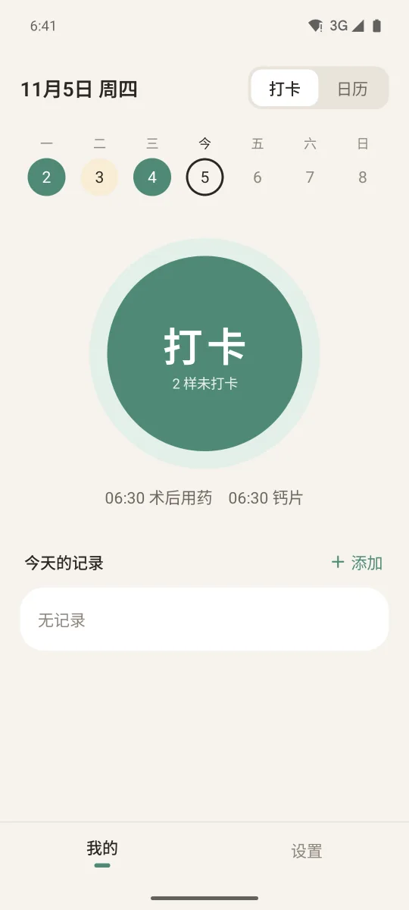
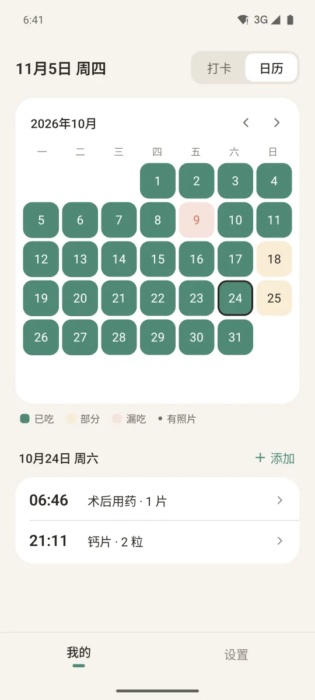
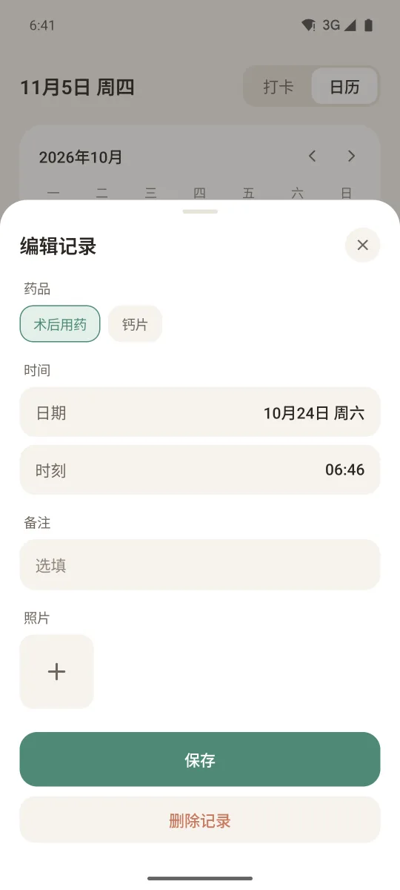

# 吃了吗

一个只做服药打卡的安卓 App。到点提醒，吃完点一下，日历上能看到哪天吃了、哪天漏了。

起因是术后每天早上 6:30 要吃药，吃完经常又睡过去，醒来记不清吃没吃。

<p>
  
  
  
</p>

## 功能

- 每种药单独设提醒时间和频率：每天、工作日、周末、指定星期、每隔 N 天
- 通知上直接点「已吃」；没点会再提醒，最多 3 次
- 打卡页一个大按钮，日历页按月看已吃 / 部分 / 漏吃
- 记录可以增删改，一天可以记多条，每条可附备注和照片
- 可选账号同步，端到端加密，服务器只存密文
- 应用内更新，深色模式

不做的事：连续天数、成就、桌面小组件。

## 构建

需要 JDK 17 和 Android SDK 35。

```bash
cd android
./gradlew testDebugUnitTest
./gradlew assembleDebug -PserverUrl=http://10.0.2.2:8096
```

`serverUrl` 是同步服务地址。正式包从 `deploy/private/site.env` 读 `SITE_URL`，这个文件不在仓库里。

同步服务是 FastAPI + SQLite：

```bash
cd server
python -m venv .venv && .venv/bin/pip install -r requirements-dev.txt
.venv/bin/python -m pytest -q tests
TODAYEAT_DATA=/tmp/te .venv/bin/uvicorn app:app --port 8096
```

## 目录

```
android/   Kotlin + Jetpack Compose + Room + WorkManager
server/    同步服务，接口都在 /api/te/ 下
web/       下载页和应用列表页
deploy/    部署脚本、systemd、nginx 补丁
docs/      SPEC.md：数据模型、同步协议、接口
```

## 文档

- [docs/SPEC.md](docs/SPEC.md)：数据模型、提醒规则、加密同步协议
- [CHANGELOG.md](CHANGELOG.md)
